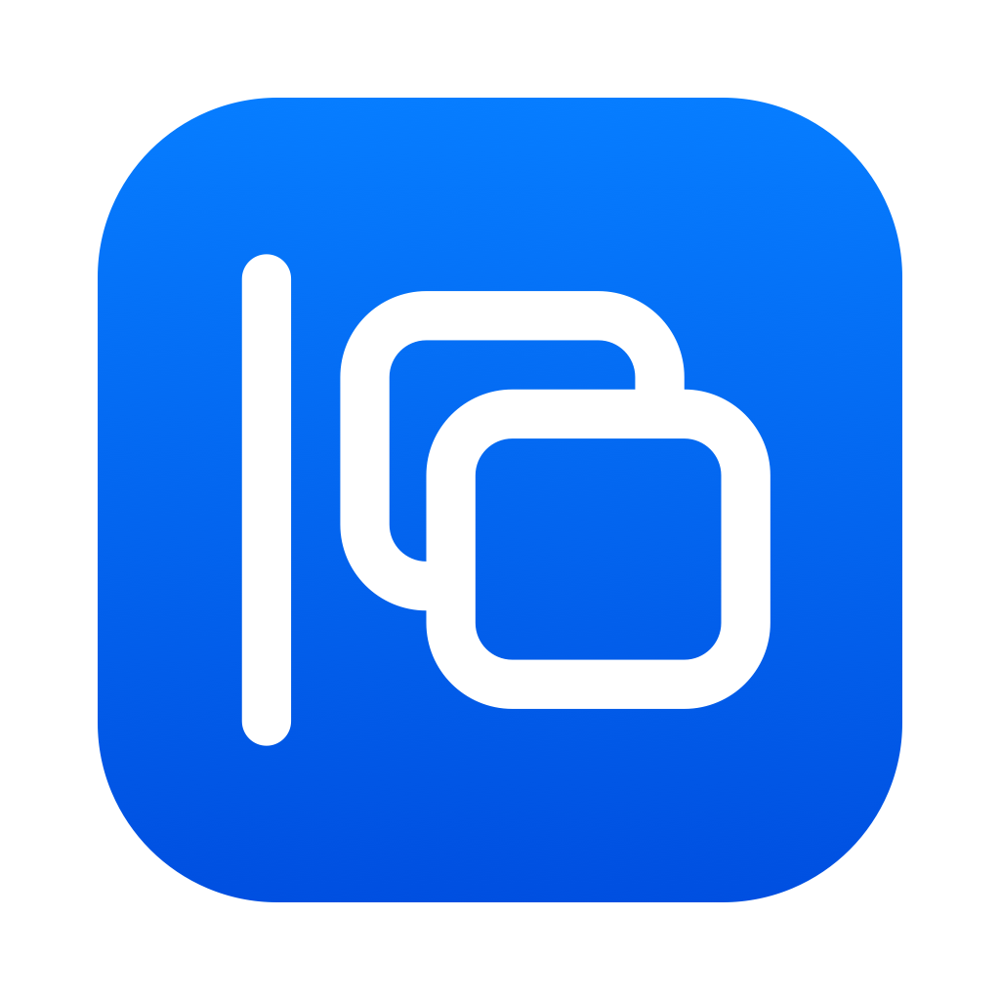
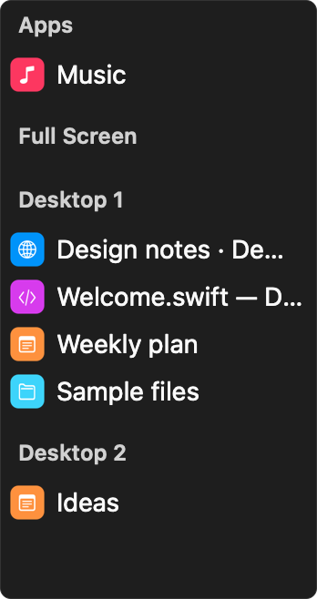
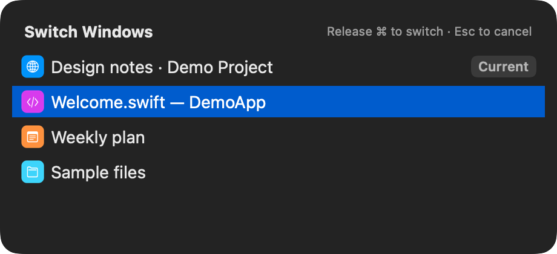
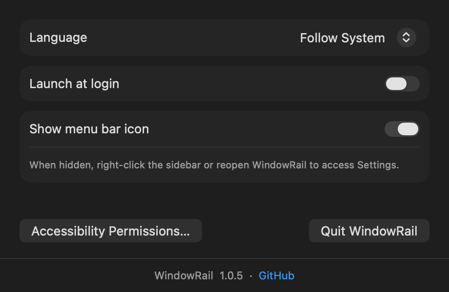

# WindowRail



English | [简体中文](README.zh-CN.md)

A lightweight window switcher for macOS. Find windows in the edge sidebar or switch with ⌘Tab and ⌘`. Includes desktop groups, a current-window marker, dark mode, English and Chinese language switching, launch at login, and a menu bar icon toggle.

## Screenshots

### Sidebar

Reveal the sidebar at the screen edge and click a window to activate it. Right-click a row to close or minimize its window, or quit the app.



### Window switcher

Hold Command to navigate, or point at a row to select it. The blue row is the destination; “Current” marks the original window. Press ⌘F in the switcher to search app names and window titles, including Chinese text.



### Settings

Choose a language and configure launch at login and menu bar visibility.



## Keyboard shortcuts

| Shortcut | Action |
| --- | --- |
| Hold ⌘ and press Tab | Cycle through windows across all apps |
| Hold ⌘ and press backtick (`) | Select a window in the current app, starting with the last-used window |
| Keep holding ⌘ and press ↑ / ↓ | Select the previous / next window |
| Add Shift | Cycle in reverse |
| Release ⌘ | Activate the selected window, except in search mode |
| ⌘F while the switcher is open | Enter search; you can then release ⌘ and type |
| ↑ / ↓ in search | Select the previous / next match |
| Return in search, or click a row | Activate the selected window |
| Esc | Cancel |

Backtick shares a physical key with `~` on many keyboards. When the switcher is closed, the app leaves normal ⌘↑ / ⌘↓ shortcuts untouched.

## Getting started

Requires **macOS 13 or later**. Builds support Apple Silicon and Intel.

1. Download a build, unzip it, and move `WindowRail.app` to a permanent location such as Applications.
2. Open the app and choose **Accessibility Permissions…** from its menu bar icon to grant access.
3. Move the pointer to the left screen edge or use a keyboard shortcut.

WindowRail does not show a Dock icon. Open **Settings…** from the menu bar icon. If you hide that icon, right-click the sidebar or reopen the running app to return to Settings.

Only one window switcher should capture the same shortcuts at a time.

## Build from source

Install Xcode Command Line Tools and Python 3.

```sh
# Create a persistent local signing identity once
python3 tools/signing.py init

# Build an app for your current architecture
./build.sh

# Build for Apple Silicon and Intel
WINDOWRAIL_ARCHS="arm64 x86_64" ./build.sh

# Run regression checks
./tools/test.sh
```

The app is created as `WindowRail.app` in the project directory. Signing credentials are stored separately and reused across builds so recompilation does not change the app’s authorization identity. Keep those credentials: builds fail if they are missing rather than silently creating a new identity.

See the [development guide](docs/DEVELOPMENT.md) for additional build and signing options.

## Inspiration

WindowRail’s interaction design is inspired by [Contexts](https://contexts.co/), focusing on three everyday features: an auto-hiding sidebar, ⌘Tab window switching, and ⌘` switching within the current app.

WindowRail is an independently developed open-source project and is not affiliated with or endorsed by Contexts or its developers.

## License

[MIT](LICENSE)
