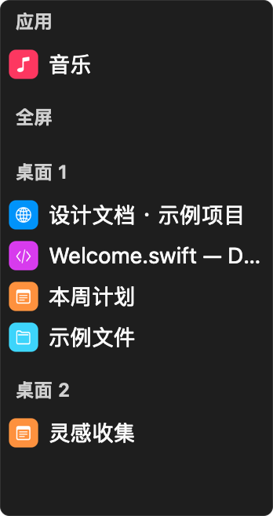
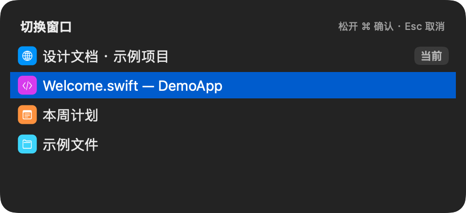
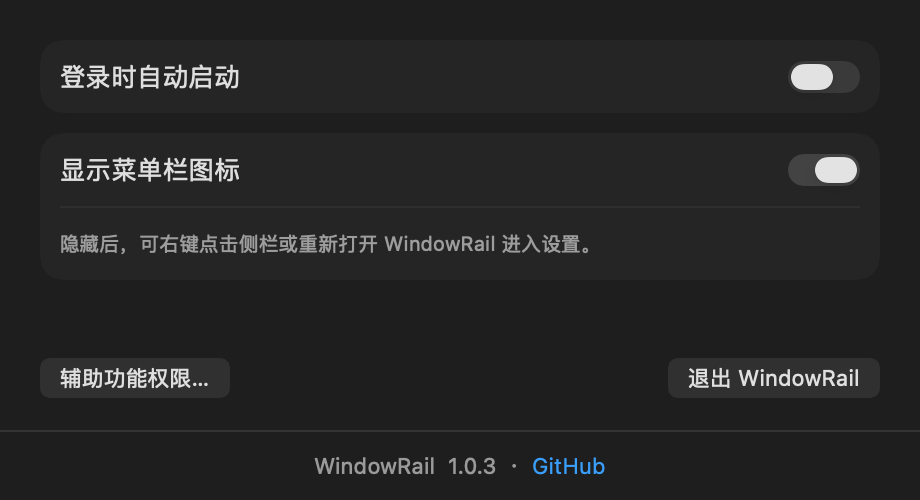

# WindowRail


[English](README.md) | 简体中文

轻量的 macOS 窗口切换工具。用贴边侧栏找到窗口，用 ⌘Tab 和 ⌘` 快速切换。支持桌面分组、当前窗口标记、深色模式、中英文切换、自启动和菜单栏图标设置。

## 界面预览

### 侧边栏

贴边展开，按桌面分组，点击即可切换窗口。右键可关闭或最小化窗口，也可退出所属应用。



### 窗口切换

按住 Command 或移动鼠标选择窗口，蓝色行表示目标窗口，“当前”标记原来正在使用的窗口。在弹窗中按 ⌘F 可搜索应用名和窗口标题，支持中文。



### 设置

切换界面语言，配置登录自启动与菜单栏图标显示。



## 快捷键

| 操作 | 行为 |
| --- | --- |
| 按住 ⌘，连续按 Tab | 选择所有应用的窗口 |
| 按住 ⌘，按反引号键（`） | 从上一次使用的窗口开始选择当前应用的窗口 |
| 继续按住 ⌘，按 ↑ / ↓ | 选择上一项 / 下一项 |
| 加 Shift | 反向选择 |
| 松开 ⌘ | 切换到选中的窗口，搜索模式除外 |
| 弹窗中按 ⌘F | 进入搜索，之后可松开 ⌘ 输入 |
| 搜索时按 ↑ / ↓ | 选择上一项 / 下一项结果 |
| 搜索时按回车，或点击某行 | 切换到选中的窗口 |
| Esc | 取消切换 |

反引号键与 `~` 共用一个物理按键。面板未打开时，不接管应用原有的 ⌘↑ / ⌘↓。

## 安装与使用

需要 **macOS 13 或更高版本**。构建支持 Apple Silicon 和 Intel。

1. 下载构建产物，解压后将 `WindowRail.app` 放到固定位置，例如“应用程序”。
2. 打开应用，从菜单栏图标进入“辅助功能权限…”，按系统提示授权。
3. 移动鼠标到屏幕左边缘，或使用快捷键切换窗口。

WindowRail 不显示 Dock 图标。设置入口在菜单栏图标的“设置…”中；隐藏菜单栏图标后，可右键点击侧栏或重新打开正在运行的应用进入设置。

同一快捷键请只交给一个窗口切换工具接管。

## 从源码构建

安装 Xcode Command Line Tools，以及 Python 3。

```sh
# 创建一次本机固定签名身份
python3 tools/signing.py init

# 构建当前架构的 .app
./build.sh

# 构建 Apple Silicon + Intel 通用版本
WINDOWRAIL_ARCHS="arm64 x86_64" ./build.sh

# 运行回归测试
./tools/test.sh
```

默认生成项目目录下的 `WindowRail.app`。签名资料保存在应用目录之外，同一份证书会被后续构建复用，避免每次编译都改变授权身份。请保留原签名资料；丢失时构建会报错，不会静默生成新身份。

更多构建与签名说明见 [开发文档](docs/DEVELOPMENT.md)。

## 灵感来源

WindowRail 的交互设计受到 [Contexts](https://contexts.co/) 启发，主要围绕三个常用功能：自动隐藏侧栏、⌘Tab 切换应用窗口，以及 ⌘` 切换当前应用的窗口。

WindowRail 是独立开发的开源项目，与 Contexts 及其开发者没有隶属或合作关系。

## License

[MIT](LICENSE)
